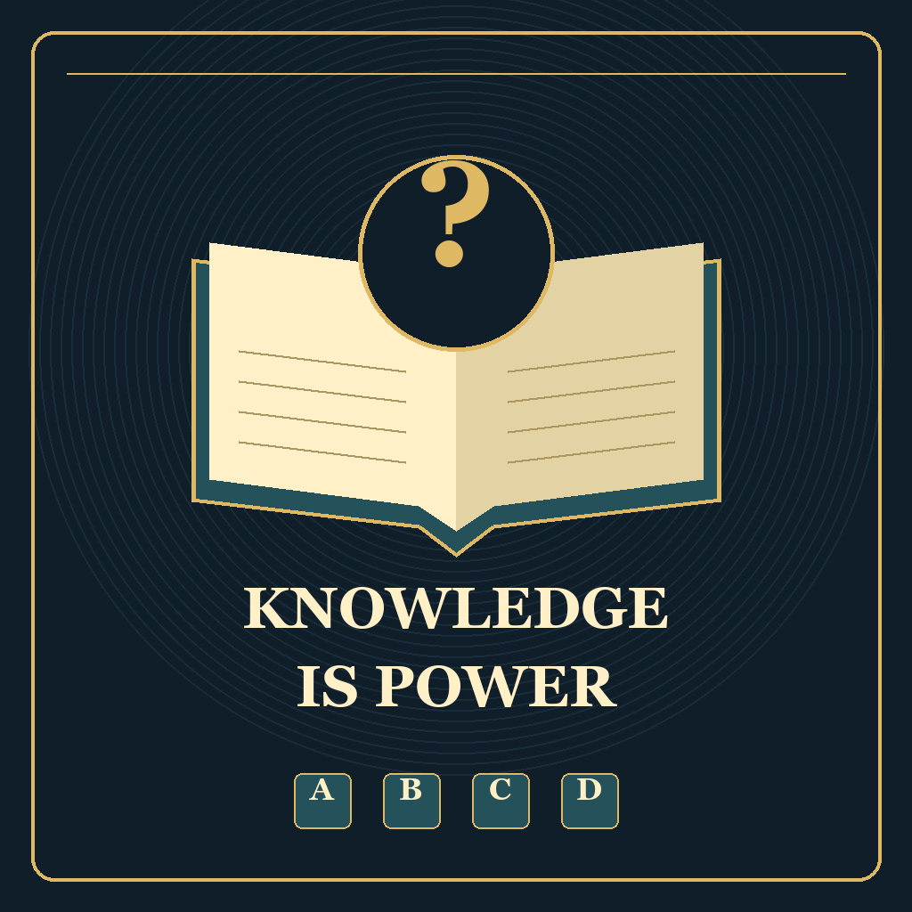

# Knowledge is Power

Version **2026.11.23.3**. An Age of Empires IV game mode combining team trivia with More Advanced Game Settings. Select **Knowledge is Power as Game Mode**. No tuning pack is required.

[Subscribe in the AoE IV mod catalogue](https://www.ageofempires.com/mods/details/594036/) · [Download the release](https://github.com/TypeDan/Knowledge-is-Power/releases/tag/v2026.11.23.3). Published as **TypeEkcyall**. The superseded listing 594034 has been removed; existing players should subscribe to the current listing.

Every **three game minutes**, a centre-screen announcement introduces a trivia round. Each team chooses one human player, randomly among those with the fewest turns. That player has **20 game seconds** to click A, B, C or D in a compact menu matching Yuletide's 272-pixel panel. All human teammates see the question and can click A, B, C or D to suggest an answer. The panel opens for everyone on the team and shows each teammate's name and current suggestion. Suggestions can be changed until the chosen player submits or the 20 seconds expire. Only the chosen player submits the final answer; advice never awards resources or causes a penalty. Other teams cannot see these suggestions. Teams containing only AI players answer automatically, with a **50% chance of success** on answered questions.

Each team has **one shared pass for the entire match**. Only the chosen answerer can press **Pass (1)** before the deadline. The question ends for that team with no reward or penalty; the control then reads **Pass used**. Passing does not reveal the answer. The pass never replenishes when rounds change, answerers rotate, or saved state is restored. AI-only teams use their pass on their first question where any member could not afford a wrong-answer bill, regardless of whether their hidden answer would be correct.

The lobby has separate **General questions** and **Christmas questions** switches. Both are on by default. Enable either or both; turn both off to play without trivia. There are **289 original multiple-choice questions: 209 general and 80 Christmas**. Each match shuffles the enabled bank using the game's synchronized random generator. Questions do not repeat until that bank is exhausted; even across reshuffles, the same question cannot appear twice in a row. Answers are shuffled too. No online trivia service or external connection is needed during play.

| Age | Team prize: each resource | Wrong answer: team penalty, each resource |
|---|---:|---:|
| I | 300 | 100 |
| II | 450 | 150 |
| III | 600 | 200 |
| IV | 900 | 300 |

A correct answer awards a **single team pot** containing food, wood, gold and stone, scaled to the answering player's age when the round opens. Every resource is divided evenly among the team's living members, including AI teammates. For example, two players answering at Age I receive 150 food, 150 wood, 150 gold and 150 stone each. Rounding remainders rotate between recipients; bigger teams do not create extra resources.

A wrong answer or timeout splits a **single team penalty equal to one-third of the prize** across the players present when the question opens. The prize and penalty use the chosen answerer's age at that moment, even in mixed-age teams. At Age I, a two-player team pays 50 of each resource per player; a four-player team pays 25. Indivisible remainder units rotate between players. Each player's charge is fixed at the start of the round; an eliminated or departed teammate's share is not added to the survivors' bills. Each player must afford all four of their resource charges. If any resource is insufficient, that player's entire resource charge is replaced by losing **10% of their currently living villagers, rounded up**. They do not also lose a partial resource payment. For example, 35 villagers means losing 4. Traders, soldiers, fishing ships and other non-villagers are excluded. If no villagers remain, no substitute unit is killed and no debt is carried forward.

The prize and personal charge are shown while the question is open. Only the selected human can submit; repeated, late, forged, old-round and other-player submissions are rejected by synchronized game logic. Answering settles the round once. If an answerer is eliminated, a surviving human teammate takes over with the original time remaining; if none remains, that team's question is cancelled without a penalty. Round progress, question deck and stakes are retained in saved state, with presentation recreated on restore. Native skirmish checks cover manual answering, shared rewards, resource penalties, villager casualties and timeouts; save/load and a match with multiple human clients have not been verified.

The inherited match settings include per-player economy and military bonuses, population ceilings with normal housing requirements, diplomacy, starting conditions and victory rules, including Vikings and Scots support. This is a separate mod with its own GUID and localization namespace. Yuletide's presents, convoy, raids and tuning definitions are not part of it.

## Source and build

Open `Knowledge is Power.aoe4mod` in the AoE IV Content Editor, then choose **Build Mod (F7)**. The output is `archives/Knowledge_is_Power.sga`. Close Content Editor before opening the Xbox/Store edition of the game. Keep the project GUID unchanged for future updates.

The editable question bank is `questions/questions.tsv`; each row is category, question, correct answer, and three distractors, separated by `|`. Run `python tools/build_questions.py` after editing it. Answer positions are randomized in-game, not fixed to A. `tools/draw_cover.py` creates the original geometric cover.

Tests require Python and `lupa`. Run the scripts under `tests/`. They exercise the shipped Lua, including mixed ages and reordered lobby slots, shared pots, affordability, rounded villager losses, answer authority, deadlines, AI outcomes, deck shuffling, category selection, HUD privacy, XAML, and the inherited population/boost fixes.

Question text is in English. Existing AGS localization is retained; new lobby labels and descriptions use English fallback in the included locales. Facts avoid current office-holders, rankings and other frequently changing answers. See [question notes](questions/NOTES.md).

## Credits

Uses More Advanced Game Settings, based on [Woprok's Advanced Game Settings](https://github.com/Woprok/AOE4-AdvancedGameSettings) and [Joshua Sachtleben's continuation](https://github.com/joshuasachtleben/AOE4-AdvancedGameSettings). The trivia system, original question wording and cover are added here. Menu styling is adapted from Yuletide Raids. See [CREDITS.md](CREDITS.md) and the retained [GPL-3.0 licence](LICENSE.md).
